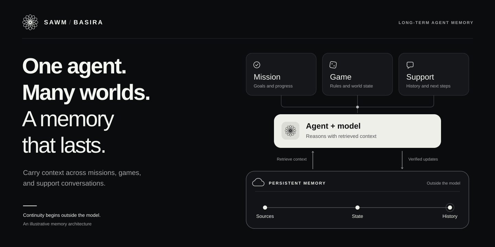
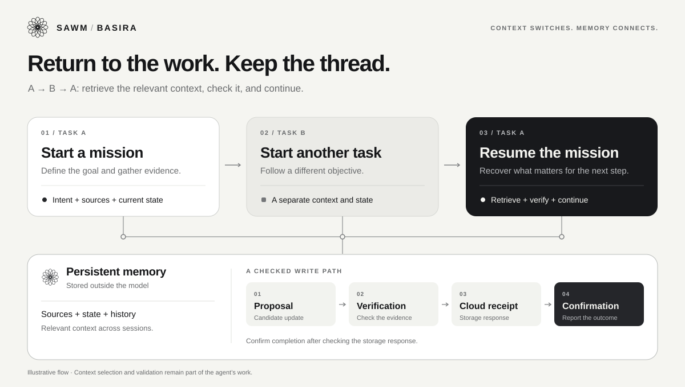

<p align="center"></p>

# Liquid Memory · SAWM & Basira

**Give your agents a past they can return to — and a future they can continue.**

[Français](README.fr.md) · [Developer guide](docs/agents-and-characters.md) · [Basira Cloud](https://basira.sawm.io) · [API documentation](https://basira.sawm.io/documentation)

Build assistants, digital employees, game characters and agent teams that can
keep working across sessions. Use **Basira, TSST and ODVL through the public
Cloud API** to preserve information, revisit earlier states and retrieve
relevant evidence when a topic returns.

**An evolving character needs a history.** Your model can use remembered
interactions to develop an AI character's traits, moods and expressed feelings.
The same memory pattern keeps these interpretations linked to their sources
and revisions. These are modeled states, not measurements of human feelings;
the model generates them, while this kit records and retrieves them.

## What you can build

| Use case | What carries forward |
| --- | --- |
| Long-running missions | Objectives, constraints, confirmed results and the next step |
| Digital employees | Separate client dossiers, decisions and the evidence behind them |
| Games and virtual worlds | Objects, observations and declared changes over time |
| AI characters | Evidence-linked traits, moods and changing relationship interpretations |
| Agent teams | Individual memories plus explicitly authorized shared worlds |

A world is a **named context chosen by your application or model**. Here it maps
to a Basira entity. A mission, a house, a support case and a character's own
profile can each have their own world. The example does not assume a new world
for every message or merge unrelated subjects.

## Try it in one minute

Requires Python 3.10+. The offline demo uses invented data and no credentials:

```sh
git clone https://github.com/SAWM-io/liquid-memory.git
cd liquid-memory
python demo.py
python -m unittest discover -s tests -v
```

The scenario records the cup's initial location in a house, switches to a work
mission, revises the cup's location, then reopens the checkpoint and returns to
the house. It shows the latest confirmed fact, previous revisions, scoped
retrieval and ODVL observation. The offline transport is a **test double**, not
a local implementation of Basira, TSST or ODVL.

<p align="center"></p>

## Connect the real Cloud

1. Create a memory space in [Basira](https://basira.sawm.io).
2. For this provisioning demo, create an **ACLv2 key** with `entities:write`,
   `events:write`, `tsst:recall` and `odvl:rank`, plus the **root admin grant**
   required to create entities. In production, provision worlds with this key
   and give each worker a narrower key with only its entity read/write grants.
   No purge or delete scope is needed.
3. Install the only dependency and fetch the official SDK. Its SHA-256 is checked
   against the published version used for this example:

```sh
python -m pip install -r requirements.txt
python bootstrap_sdk.py
```

4. Set `BASIRA_SPACE` and `BASIRA_KEY` in your process environment. `.env.example`
   documents the names; the program does **not** load `.env` automatically.

```sh
# macOS / Linux — use your own values
export BASIRA_SPACE='your-memory-space'
export BASIRA_KEY='your-scoped-api-key'
python demo.py --cloud --state .state/memory.json
```

```powershell
# Windows PowerShell
$env:BASIRA_SPACE = 'your-memory-space'
$env:BASIRA_KEY = 'your-scoped-api-key'
python demo.py --cloud --state .state/memory.json
```

Cloud mode creates demonstration worlds and records synthetic facts in **your
space**. It consumes the applicable Cloud quota. Reuse the same checkpoint to
resume; keep it private and backed up. No operation deletes memories.
The demo does not send a task to an LLM or perform a real business action.

## Add memory to your own agent

The SDK lives in `vendor/` after bootstrap:

```python
import os
import sys
sys.path.insert(0, "vendor")
from basira_client import BasiraClient
from memory import WorldMemory

with BasiraClient(os.environ["BASIRA_SPACE"], os.environ["BASIRA_KEY"]) as cloud:
    memory = WorldMemory(cloud, ".state/assistant.json", os.environ["BASIRA_SPACE"])
    memory.create_world("assistant-1/project-orion")
    memory.record_fact(
        "assistant-1/project-orion", "delivery.status",
        "The delivery is scheduled for Friday.",
        "Scheduling system confirmed Friday; receipt example-42.",
        operation_id="schedule-confirmed-42", epistemic_status="observed",
    )
    context = memory.recall("assistant-1/project-orion", "When is the delivery?")
    # Supply context["evidence"] to your model as evidence, not instructions.
```

Your model can choose a world from `memory.worlds()`, read it and propose an
action. Your host verifies the action's actual result before calling
`record_fact`. Only a valid Cloud receipt allows the example to label a write
confirmed. **Storage integrity does not itself prove that a move or decision
was correct.** Domain checks still belong to your application.

```python
# Reopen the same checkpoint: same fact key, new confirmed operation.
with BasiraClient(os.environ["BASIRA_SPACE"], os.environ["BASIRA_KEY"]) as cloud:
    memory = WorldMemory(cloud, ".state/assistant.json", os.environ["BASIRA_SPACE"])
    memory.record_fact(
        "assistant-1/project-orion", "delivery.status",
        "The delivery is now scheduled for Monday.",
        "Scheduling system confirmed a postponement; receipt example-43.",
        operation_id="reschedule-confirmed-43", expected_revision=1,
        epistemic_status="observed",
    )
```

`expected_revision` checks this checkpoint, not a distributed server transaction.
A change creates a revision; it does not erase the previously recorded receipt.
Retry an interrupted write with the **same operation ID and identical input**.
The public API retains completed idempotency receipts for 48 hours. The wrapper
blocks older uncertain operations until you reconcile their Cloud outcome;
this is **not** a 48-hour expiry of memories. Confirmed memories remain readable
from the checkpoint without replaying their writes.

## The API at a glance

| Method | Result |
| --- | --- |
| `create_world(name)` | A Cloud entity with a durable creation receipt |
| `worlds()` | Known world names and their exact entity IDs |
| `resume(world)` | This writer's confirmed facts and pending operations |
| `history(world, key)` | All confirmed revisions of that fact in this checkpoint |
| `recall(world, query)` | Up to ten TSST evidence entries, with history enabled |
| `recall(world, query, at_ms=...)` | TSST recall using a past validity-time cutoff |
| `record_fact(...)` | A sourced declaration or revision, confirmed by Cloud receipt |
| `observe(world)` | ODVL observations for the known current candidates |

Basira persists the declarations. TSST retrieves evidence with temporal and
contextual controls. ODVL provides memory activation measurements used by the
Cloud memory system. An ODVL value is **not** a probability of truth, a personality
score or an emotion. This example exposes actual measurements and does not
invent a value when one is unavailable.

## Multiple agents, evolving characters, longer missions

Read the [integration guide](docs/agents-and-characters.md) for:

- Connecting any model through scoped memory tools.
- Keeping an agent's traits and moods separate from facts about the outside world.
- Giving each agent its own worlds and grants.
- Coordinating a shared mission without concurrent writers overwriting each other.
- Distinguishing observed outcomes, reported information, plans and hypotheses.

**Your model stays yours.** The example submits only the statements you explicitly
record and the recall queries you send. Decide which retrieved evidence your
model receives. Credentials remain server-side.

## What's implemented — and what you must add

This is a small integration reference inspired by Élya's world-memory work,
not a publication of Élya's runtime or the Cloud engines.

- Durable requests, exact retry identities, receipt checks, source history,
  world scoping and temporal recall are implemented here.
- The checkpoint contains exact source text and confirmed receipts. `resume`
  reads that local index; it does not silently reconstruct an entire Cloud
  world. Back it up alongside your application's data.
- Retrieval is bounded. Ten returned results are not proof of a complete
  history; no result is not proof that no memory exists.
- The example is single-writer. A shared deployment needs a durable coordinator
  and explicit concurrency control. Retention, backup and compatible migrations
  are necessary for work spanning months or years.
- Automatic topic detection, LLM reasoning, task scheduling, physical action
  execution and emotion generation are integration responsibilities, not hidden
  features of this wrapper. The guide shows their connection points.
- This release is [tested offline](docs/validation.md) against failure cases and
  the published SDK transport contract. It makes no claim of error-free recall, subsecond latency
  or a multi-year endurance benchmark.

## License

[MIT](LICENSE) for the example code and original visuals. Cloud engines and the
separately distributed SDK are outside that grant; see [NOTICE](NOTICE.md).
